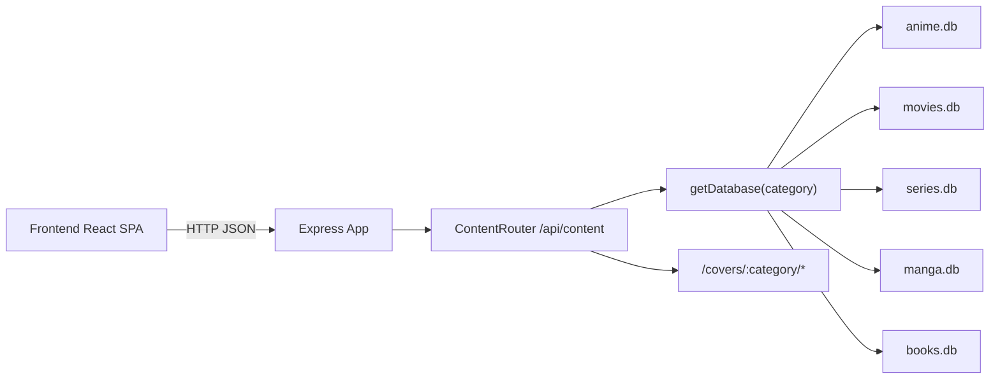

# Golden Media Backend

Backend‑часть проекта Golden Media — это REST API для учёта сериалов, фильмов, аниме, манги и книг.  
Сервис хранит данные в отдельных SQLite‑базах по категориям и обслуживает React‑клиент.

## Архитектура и стек

- **Платформа**: Node.js
- **Язык**: TypeScript
- **Фреймворк**: Express 4
- **База данных**: SQLite (по одной базе на каждую категорию)
- **Работа с БД**: `sqlite` + `sqlite3`
- **Загрузка файлов**: `multer` (обложки постеров)
- **Конфигурация**: `dotenv`
- **CORS**: `cors`

Архитектура логически делится на:

- **Точку входа и конфигурацию приложения** (`server.ts`, `app.ts`)
- **Маршруты API** (`routes/content.ts`)
- **Слой доступа к данным** (`db/connection.ts` + файлы `.db`)
- **Файловое хранилище обложек** (`data/covers`)

Упрощённая диаграмма:



## Структура файлов и папок

Корень backend:

- `package.json` — метаданные пакета, скрипты (`dev`, `build`, `start`), список зависимостей.
- `tsconfig.json` — конфигурация TypeScript для backend.
- `src/` — исходный код сервера.
- `src/data/databases/` — SQLite‑файлы по категориям.
- `src/data/covers/` — директория для хранения обложек (создаётся по мере загрузки файлов).

Директория `src`:

- `src/server.ts`
  - Загружает переменные окружения через `dotenv`.
  - Импортирует готовое Express‑приложение из `app.ts`.
  - Определяет порт (`PORT` из окружения либо `4000` по умолчанию).
  - Запускает HTTP‑сервер и логирует URL.

- `src/app.ts`
  - Создаёт экземпляр `express()`.
  - Подключает middleware:
    - `cors()` — разрешает кросс‑доменные запросы для фронтенда.
    - `express.json()` — парсинг JSON‑тел запроса.
  - Настраивает статику обложек:
    - Вычисляет путь к `src/data/covers`.
    - Публикует его как `/covers` (например, `/covers/anime/...`).
  - Определяет базовые маршруты:
    - `GET /` — текстовый ответ‑заглушка.
    - `GET /health` — проверка живости `{ status: "ok" }`.
  - Подключает основной роутер:
    - `app.use("/api/content", contentRouter)`.

- `src/routes/content.ts`
  - Роутер `express.Router()` для `"/api/content"`.
  - Настраивает `multer` для сохранения обложек:
    - Базовая директория `src/data/covers/:category`.
    - Автоматическое создание подкаталогов по категориям.
    - Безопасное формирование имен файлов (санитизация).
  - Маршруты:
    - `GET /:category`
      - Возвращает список контента с фильтрацией и пагинацией.
      - Поддерживаемые параметры:
        - `status` — один или несколько статусов через запятую.
        - `title` — поиск по названию (русское и оригинальное).
        - `genres` — жанры через запятую.
        - `season` — сезон/год (кроме фильмов).
        - `year` — год выхода из `release_date`.
        - `studio` — поиск по студии/режиссёру.
        - `sortBy` / `sortDir` — сортировка по названию, рейтингу, эпизодам, сезону, студии, прогрессу.
        - `page`, `pageSize` — пагинация.
      - Возвращаемый формат:
        - `{ items, total, page, pageSize }`.
    - `POST /import/shikimori/anime`
      - Принимает JSON‑экспорт Shikimori (массив аниме).
      - Маппит статусы Shikimori → внутренние статусы.
      - Добавляет записи в базу `anime`, пропуская дубликаты по названию.
    - `POST /:category`
      - Создаёт новую запись.
      - Принимает как `multipart/form-data` (поле `cover`), так и только текстовые поля.
      - Нормализует и валидирует поля (название обязательно, значения рейтинга/эпизодов/дат).
      - Для статусa `"Смотрю"` и `"Просмотрено"` может проставлять даты начала/окончания просмотра.
    - `PUT /:category/:id`
      - Обновляет существующую запись.
      - Поддерживает смену обложки (файл/URL), изменение статуса и связанных дат просмотра.
    - `DELETE /:category/:id`
      - Удаляет запись.

- `src/db/connection.ts`
  - Тип `ContentCategory` — перечисление категорий: `"anime" | "movies" | "series" | "manga" | "books"`.
  - `getDatabase(category: ContentCategory)`
    - Вычисляет путь к каталогу `src/data/databases`.
    - Создаёт директорию при отсутствии.
    - Открывает файл `<category>.db` через `sqlite`.
    - Гарантирует наличие/актуальность схемы таблицы `content` (функция `ensureSchema`).
  - `ensureSchema(db)`
    - Создаёт таблицу `content`, если её ещё нет.
    - Создаёт уникальный индекс по `title`.
    - Добавляет дополнительные колонки, если они отсутствуют:
      - `original_title`
      - `duration_text`
      - `view_start_date`
      - `view_end_date`

- `src/data/databases/`
  - `anime.db`, `movies.db`, `series.db`, `manga.db`, `books.db` — отдельные SQLite‑файлы для каждой категории.

- `src/data/covers/`
  - Корневая папка для файлов обложек.
  - Внутри по категориям: `anime/`, `movies/`, `series/`, `manga/`, `books/`.
  - Обслуживается как статика по пути `/covers`.

## Установка и запуск

### Требования

- Node.js (актуальная LTS‑ветка)
- npm

### Установка зависимостей

Из корня репозитория:

```bash
cd backend
npm install
```

### Переменные окружения

В корне репозитория есть пример файла окружения:

- `.env.example`

Создайте `.env` в той же директории (рядом с `backend`), скопировав и при необходимости изменив значения:

```bash
cp .env.example .env
```

Ключевые переменные:

- `PORT` — порт HTTP‑сервера (по умолчанию `4000`).

### Режим разработки

Из директории `backend`:

```bash
npm run dev
```

- Запускает `ts-node-dev` с `src/server.ts`.
- Перезапускает процесс при изменении файлов TypeScript.
- По умолчанию backend доступен по адресу: `http://localhost:4000`.

### Сборка и продакшен‑запуск

1. Собрать TypeScript в JavaScript:

   ```bash
   npm run build
   ```

2. Запустить собранную версию:

   ```bash
   npm start
   ```

- Сгенерированные файлы попадают в директорию `dist/`.
- Точка входа продакшен‑сборки — `dist/server.js`.

## Обзор API

Базовый URL (по умолчанию): `http://localhost:4000`.

### Служебные маршруты

- `GET /` — простой текстовый ответ, сигнализирующий о работе API.
- `GET /health` — проверка состояния сервера:
  - Ответ: `{ "status": "ok" }` при нормальной работе.

### Основной ресурс: `/api/content`

Все маршруты ниже используют параметр `:category`, который должен быть одним из:

- `anime`
- `movies`
- `series`
- `manga`
- `books`

#### GET `/api/content/:category`

Возвращает список записей выбранной категории с возможностью фильтрации, сортировки и пагинации.

Примеры параметров запроса:

- `status=Просмотрено,Смотрю`
- `title=Evangelion`
- `genres=фэнтези,драма`
- `season=Лето`
- `year=2014`
- `studio=Gainax`
- `sortBy=rating&sortDir=desc`
- `page=1&pageSize=50`

Формат ответа:

```json
{
  "items": [ /* записи таблицы content */ ],
  "total": 123,
  "page": 1,
  "pageSize": 50
}
```

#### POST `/api/content/import/shikimori/anime`

Импортирует массив записей из JSON‑экспорта Shikimori для аниме.

- Тело запроса: JSON‑массив объектов с полями вроде `target_title`, `target_title_ru`, `target_type`, `score`, `status`, `episodes`.
- Результат: объект с количеством импортированных/пропущенных записей.

#### POST `/api/content/:category`

Создаёт новую запись. Поддерживает:

- `multipart/form-data` с файлом `cover` (обложка).
- либо только поля формы (без файла).

Ключевые поля:

- `title` (обязательно)
- `original_title`
- `status`
- `rating`
- `episodes_total` / `episodes_watched` (или продолжительность в секундах для фильмов)
- `season` или `release_date` (в зависимости от категории)
- `genres`
- `studio`
- `duration_text` (например, «23 мин.» для аниме)
- `view_start_date`, `view_end_date`

#### PUT `/api/content/:category/:id`

Обновляет существующую запись по `id`. Логика похожа на `POST`, но используется для частичного/полного изменения записи и смены обложки.

#### DELETE `/api/content/:category/:id`

Удаляет запись.

## Обслуживание статики обложек

- Статические файлы обложек отдаются по пути:
  - `/covers/:category/имя_файла`
- Фронтенд строит ссылки вида:
  - `http://localhost:4000/covers/anime/название-файла.jpg`

При загрузке через `multer` файлы автоматически попадают в нужную поддиректорию `src/data/covers/:category`.

