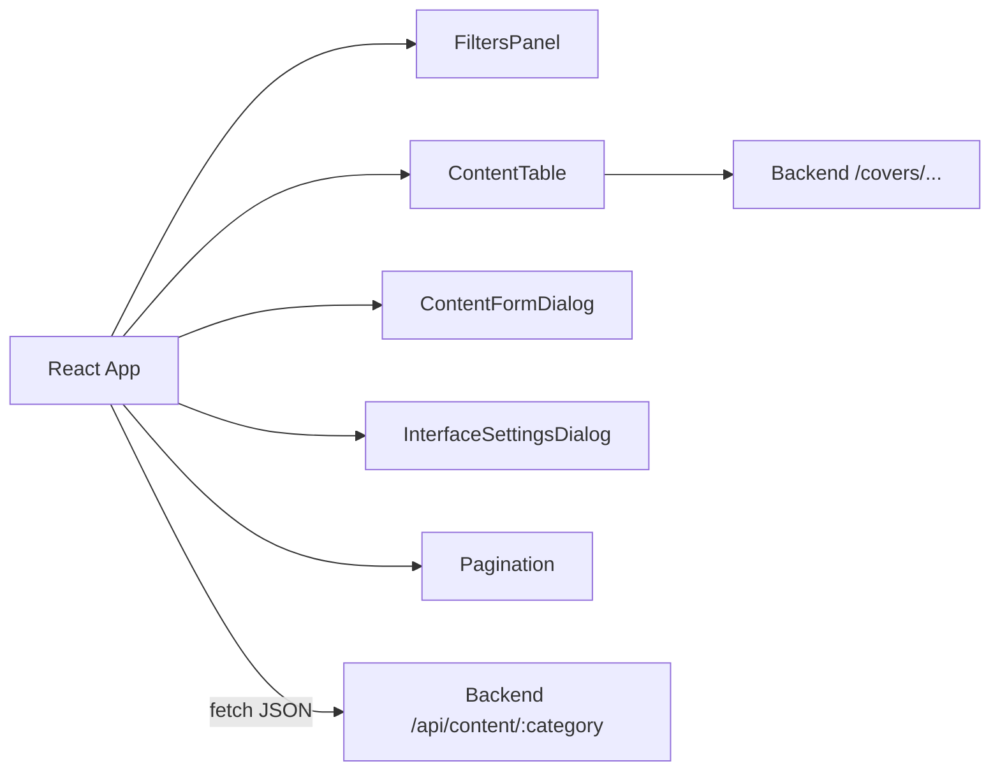

# Golden Media Frontend

Frontend‑часть проекта Golden Media — это одностраничное приложение (SPA) на React + Vite,  
которое предоставляет удобный интерфейс для ведения личного каталога сериалов, фильмов, аниме, манги и книг.

## Архитектура и стек

- **Сборщик / Dev‑сервер**: Vite
- **Фреймворк**: React 19
- **Язык**: TypeScript
- **Линтинг**: ESLint 9 + набор плагинов для React и TypeScript

Приложение построено как SPA:

- Входная точка рендеринга — `src/main.tsx`, монтирует `App` в `<div id="root">`.
- Компонент `App` управляет:
  - активной категорией (аниме/фильмы/сериалы/манга/книги),
  - фильтрами и сортировкой,
  - пагинацией,
  - формой создания/редактирования записи,
  - настройками интерфейса (размер обложек, отображение оригинального названия),
  - обращениями к backend‑API.
- Состояние распределено между:
  - `App` (глобальное состояние текущего экрана),
  - подкомпонентами (панель фильтров, таблица, диалог формы, диалог настроек).

Упрощённая схема взаимодействия:



## Структура файлов и папок

Корень frontend:

- `package.json` — метаданные, зависимости, скрипты (`dev`, `build`, `lint`, `preview`).
- `vite.config.ts` — конфигурация Vite с React‑плагином.
- `tsconfig.json`, `tsconfig.app.json`, `tsconfig.node.json` — конфигурации TypeScript для приложения и вспомогательных скриптов.
- `eslint.config.js` — общая конфигурация ESLint.
- `index.html` — HTML‑шаблон с контейнером `<div id="root">`.
- `src/` — исходный код клиентского приложения.

Директория `src`:

- `src/main.tsx`
  - Импортирует глобальные стили `index.css`.
  - Создаёт корень React с помощью `createRoot(...)`.
  - Рендерит `<App />` внутри `React.StrictMode`.

- `src/App.tsx`
  - Главный компонент приложения:
    - Хранит состояние:
      - выбранная категория (`series`, `movies`, `anime`, `manga`, `books`),
      - список элементов,
      - флаги загрузки/ошибки,
      - фильтры (статусы, поиск по названию, жанрам, сезону, году, режиссёру/студии),
      - сортировка (по названию, рейтингу, эпизодам, сезону, студии, прогрессу),
      - пагинация (номер страницы, размер страницы, общее количество),
      - состояние диалога создания/редактирования (`ContentFormDialog`),
      - настройки интерфейса (`coverSize`, `showOriginalTitle`),
      - вспомогательные поля формы (даты просмотра, длительность, путь/файл обложки и др.).
    - Через `useEffect` загружает данные с backend:
      - Формирует `URLSearchParams` из текущих фильтров и сортировки.
      - Делает запрос на `GET {API_BASE}/api/content/:category`.
      - Обновляет список элементов и общее количество.
    - Управляет обработчиками:
      - смена сортировки (`handleSortClick`),
      - смена страницы и размера страницы,
      - открытие/закрытие формы создания и редактирования,
      - удаление записи,
      - сабмит формы (`handleFormSubmit`) с отправкой `FormData` на backend (`POST` / `PUT`),
      - импорт аниме из Shikimori (`handleShikimoriImport`),
      - сохранение настроек интерфейса в `localStorage`.
    - Подключает ключевые компоненты:
      - `CategoryTabs`
      - `Toolbar`
      - `FiltersPanel`
      - `ContentTable`
      - `Pagination`
      - `ContentFormDialog`
      - `InterfaceSettingsDialog`

- `src/domain.ts`
  - Определяет доменные типы:
    - `Category` — категории контента.
    - `Status` — статусы (Запланировано, Смотрю, Просмотрено, и т.д.).
    - `SortBy` — ключи сортировки.
    - `ContentItem` — тип записи, соответствующий строкам таблицы `content` в БД.
    - `PaginatedContentResponse` — структура ответа от backend.
  - Содержит константы:
    - `STATUSES` — список возможных статусов.
    - `CATEGORIES` — список категорий с человекочитаемыми названиями.
  - Вспомогательная функция:
    - `getStatusClassName(status)` — возвращает CSS‑класс для раскраски статуса.

- `src/utils/api.ts`
  - `API_BASE` — базовый URL backend (по умолчанию `http://localhost:4000`).
  - `getApiBase()` — возвращает базовый URL (используется в `App.tsx`).
  - `buildCoverUrl(path)` — строит абсолютный URL обложки:
    - если путь начинается с `http://` или `https://`, возвращается как есть;
    - если путь начинается с `/`, дописывается `API_BASE`;
    - иначе добавляется префикс `API_BASE/`.

- `src/utils/time.ts`
  - Вспомогательные функции для работы со временем и датами:
    - `formatTime(totalSeconds)` — форматирование `секунды → чч:мм:сс`.
    - `parseDurationToSeconds("чч:мм:сс")` — парсинг строки в секунды.
    - `formatDateShort(iso)` / `parseDateShortToIso("ДД.ММ.ГГГГ")` — конвертация между кратким форматом и ISO‑датой.
    - `formatViewPeriod`, `formatViewPeriodInline` — отображение периода просмотра и длительности.
    - `formatDurationDaysMonths`, `formatHoursMinutes` — удобное отображение длительности в человекочитаемом виде.

- `src/App.css`, `src/index.css`
  - Базовые стили и оформление:
    - компоновка карточек,
    - таблица,
    - фильтры, кнопки, табы,
    - диалоги,
    - прогресс‑бар и т.п.

### Компоненты главного окна (`src/components/MainWindow`)

- `CategoryTabs.tsx`
  - Отображает вкладки категорий (`Сериалы`, `Фильмы`, `Аниме`, `Манга`, `Книги`).
  - Поддерживает выбор активной категории и визуальную подсветку.

- `Toolbar.tsx`
  - Простая панель инструментов.
  - Содержит кнопку «Добавить запись», которая открывает диалог создания.

- `FiltersPanel.tsx`
  - Панель фильтров:
    - выбор статусов (чипы со сбросом «Все»),
    - поиск по названию (русское / оригинальное),
    - поиск по жанрам,
    - фильтр по сезону и году (для аниме/сериалов и др.),
    - фильтр по режиссёру/студии и году выхода (для фильмов).
  - Не хранит состояние внутри себя — всё состояние фильтров живёт в `App` и передаётся через пропсы.

- `ContentTable.tsx`
  - Основная таблица контента:
    - отображает список записей для выбранной категории,
    - поддерживает кликабельные заголовки для сортировки,
    - показывает обложку (через `buildCoverUrl`), статус (с цветами), оценку,
    - выводит эпизоды/страницы или длительность (с учётом категории),
    - отображает сезоны/годы, жанры, студию/режиссёра,
    - показывает прогресс (`ProgressBar`) и действия (Редактировать/Удалить).
  - Использует:
    - `renderEpisodesOrDuration` для вывода прогресса по эпизодам/времени,
    - функции из `time.ts` для дат и периодов просмотра.

- `ContentFormDialog.tsx`
  - Диалог создания/редактирования записи:
    - работает в режимах `"create"` и `"edit"`,
    - управляет формой с полями:
      - название и оригинальное название,
      - статус, оценка,
      - обложка (режимы: файл/URL с предпросмотром),
      - количество эпизодов/страниц или длительность (`чч:мм:сс`),
      - сезон/год, жанры, студия/режиссёр,
      - даты просмотра (для фильмов),
      - продолжительность (текстом) для аниме.
    - не хранит данные записи у себя, а получает значения/обработчики через пропсы от `App`.

- `Pagination.tsx`
  - Отображает панель пагинации:
    - выбор размера страницы (20 / 50 / 100),
    - управление переходами между страницами,
    - окно номеров страниц вокруг текущей.
  - Держит только вычисляемое состояние (safePage), всё остальное приходит снаружи.

- `renderEpisodesOrDuration.tsx`
  - Вспомогательная функция для вывода эпизодов/длительности:
    - для фильмов и аниме использует `formatTime`,
    - для остальных категорий показывает `watched / total`.

### Компоненты настроек и UI

- `src/components/Settings/InterfaceSettingsDialog.tsx`
  - Диалог настроек интерфейса:
    - выбор размера обложек (small/medium/large),
    - выбор способа отображения названий (русские / оригинальные),
    - для категории `anime` — кнопка «Импорт из Shikimori JSON» с выбором файла.
  - Не хранит настройки самостоятельно, а взаимодействует с состоянием `App` через пропсы.

- `src/components/UI/ProgressBar.tsx`
  - Отображает прогресс (в процентах) по количеству просмотренного:
    - принимает `watched` и `total`,
    - вычисляет `%` и рисует полоску с подписью.

## Связь с backend

- Базовый URL backend жёстко задан в `src/utils/api.ts`:
  - `API_BASE = "http://localhost:4000"`.
- Все запросы выполняются из `App.tsx`:
  - загрузка списка: `GET {API_BASE}/api/content/:category` с параметрами фильтров и пагинации,
  - создание/обновление: `POST`/`PUT` `{API_BASE}/api/content/:category`,
  - удаление: `DELETE {API_BASE}/api/content/:category/:id`,
  - импорт: `POST {API_BASE}/api/content/import/shikimori/anime`.
- Обложки подгружаются по URL, построенному `buildCoverUrl`, чаще всего:
  - `http://localhost:4000/covers/:category/имя_файла`.

## Установка и запуск

### Требования

- Node.js (актуальная LTS‑ветка)
- npm
- Запущенный backend Golden Media (по умолчанию `http://localhost:4000`)

### Установка зависимостей

Из корня репозитория:

```bash
cd frontend
npm install
```

### Режим разработки

Из директории `frontend`:

```bash
npm run dev
```

- Запускает Vite dev‑сервер (по умолчанию на `http://localhost:5173`).
- Прокси до backend не используется — обращения идут напрямую на `http://localhost:4000`.

### Сборка и предпросмотр

1. Собрать TypeScript и бандл:

   ```bash
   npm run build
   ```

2. Запустить локальный preview‑сервер:

   ```bash
   npm run preview
   ```

- Preview‑сервер также будет ожидать доступный backend по `http://localhost:4000`.

## Запуск всего проекта

В корне репозитория есть вспомогательный скрипт:

- `start-dev.bat` — открывает два окна `cmd`:
  - одно для `backend` (`npm run dev` на порту 4000),
  - одно для `frontend` (`npm run dev` на порту 5173).

Используйте его, если вы на Windows и хотите быстро поднять оба сервиса для разработки.

## Основные пользовательские сценарии

- **Выбор категории**:
  - Переключение вкладок (аниме/фильмы/сериалы/манга/книги).
  - Для каждой категории хранится и отображается свой список.

- **Фильтрация и поиск**:
  - Фильтрация по статусам (Запланировано, Смотрю, Просмотрено, и т.д.).
  - Поиск по названию (русскому и оригинальному).
  - Поиск по жанрам, сезону, году, режиссёру/студии.

- **Создание и редактирование записи**:
  - Через диалог `ContentFormDialog` можно:
    - задать название и оригинальное название,
    - выбрать статус, оценку,
    - указать длительность/эпизоды, жанры, сезон/год, студию/режиссёра,
    - добавить обложку (файл или URL),
    - сохранить даты просмотра и дополнительные поля.

- **Импорт из Shikimori**:
  - В настройках интерфейса (для категории `anime`) доступен импорт JSON:
    - выбирается файл экспорта Shikimori,
    - данные отправляются на backend,
    - новые записи добавляются в каталог.

- **Настройки интерфейса**:
  - Размер карточек/обложек (мелкий/средний/крупный).
  - Отображение русских или оригинальных названий.
  - Настройки сохраняются в `localStorage` и применяются между перезапусками.

